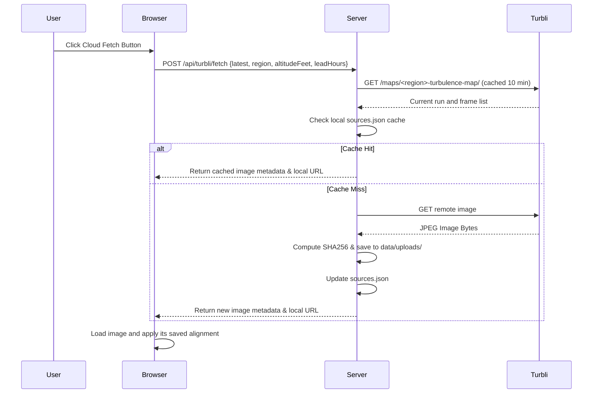

# Turbli GPS

A dependency-light local web app for aligning Turbli turbulence forecast images over a GPS-aware US state map.

## Features

- Browser GPS watch with copyable latitude/longitude, altitude, and accuracy display.
- US state outline map using Web Mercator.
- Turbulence grid: Turbli's global clear-air turbulence (CAT) forecast drawn as a heatmap in the app's own projection, so it lines up exactly in any region.
- Regions for the US, Europe, Asia, the North Atlantic, the world, and any flight route typed as two airport codes (for example `SEA-MUC`), drawn as a great circle.
- Turbli image overlay with drag, scale, rotation, paste, drop, and file upload support.
- Autofit, which aligns the outlines with a pasted or fetched map image and picks the image's projection.
- Local source and alignment persistence by image hash, source, and source family.
- No external Python packages required for the core server or browser client.

## Architecture

The application is split between a lightweight Python HTTP server backend and a Vanilla JS/CSS frontend. The backend handles local storage of images and transform matrices, as well as proxying fetch requests to Turbli.com. The frontend handles rendering the SVG map, overlaying the image, touch/mouse gesture transformations, and browser geolocation.

```mermaid
graph TD
    subgraph Frontend [Browser]
        UI[Vanilla HTML/CSS/JS]
        Map[SVG Map Rendering]
        Gestures[Touch/Mouse Gestures]
        GPS[Browser Geolocation API]
        UI <--> Map
        UI <--> Gestures
        UI <--> GPS
    end

    subgraph Backend [Python 3 Server]
        HTTP[http.server.ThreadingHTTPServer]
        App[TurbliApp Core Logic]
        Storage[JSON File Storage]
        HTTP <--> App
        App <--> Storage
    end

    subgraph External [External Services]
        Turbli[Turbli.com (Images)]
    end

    UI <-->|JSON API / Static Files| HTTP
    App <-->|HTTPS GET| Turbli
```

### Data Flow: Fetching Turbli Image



### Turbulence grid

turbli.com's interactive map loads one forecast hour at a time from
`POST /maps/interactive-turbulence-map/get_forecast_hour/` with form fields
`hour` (lead time) and `file_name` (the run's CAT hour, for example `009`).
The response is a global 1-degree grid (181 x 360, south row and west column
first) of EDR x 100 at every altitude. The server stores each altitude as a
byte array under `data/grids/`, so changing altitude needs no further download,
and the browser colours it with Turbli's own scale.

### Autofit

Autofit aligns the wireframe with a map image by truncated chamfer matching:

1. Dark, unsaturated pixels form the line mask. This keeps coastlines and borders and drops the coloured turbulence and the white background.
2. A distance transform of the mask becomes a score map that is 1 on a line and falls to 0 a few pixels away.
3. For Mercator, Miller and equirectangular outlines in turn, an exhaustive search over scale and translation on a small copy of the image finds candidate fits. The outlines must span 40% to 200% of the image, which stops them shrinking onto one dense patch of lines.
4. A local pattern search over scale, rotation and translation refines each candidate on a larger copy.
5. The best fit sets the overlay transform and the map projection. A mean score below 0.45 is reported as a failure and leaves the alignment unchanged.

Turbli's US and Europe maps match Mercator outlines and its World map matches Miller outlines. Select the region the image shows before running autofit.

### Turbli runs

Turbli serves its maps from `/databases/GTG_<date>_<HH>/figures/CAT_<hour>_<altitude>_<region>.jpg`.
The following facts about that layout drive the fetch logic:

- Only the current run exists. Older runs return the origin's own HTTP 403 page, which is not a bot block.
- A run labelled `HH` is published about two hours before `HH:00Z`, and turbli.com labels its `CAT_006` frame "Now". The app therefore dates `CAT_<hour>` at `HH:00Z - 6 h + hour`.
- Frames run from `CAT_006` to `CAT_036` every 3 hours, at 15,000, 20,000, 25,000, 30,000, 33,000, 36,000 and 39,000 ft.
- The map page names the current run, so a fetch normally costs one page request and one image request. When the page is unavailable, the server tries at most three run labels, newest first.
- Cloudflare rejects requests without a browser-like `User-Agent` (error 1010) and blocks hotlinking from other origins, so images are fetched by the server rather than by the browser. If Cloudflare blocks the server, the error says so; paste the image from turbli.com instead.

## Installation

The core application has **no external dependencies** beyond Python 3 standard library.
However, to run the test suite with coverage, you need `pytest` and `pytest-cov`.

```bash
# Optional: Create a virtual environment for tests
python3 -m venv venv
source venv/bin/activate

# Install test dependencies (only needed for testing)
pip install pytest pytest-cov
```

## Run

You can run the server directly using Python or via the provided shell script.

```bash
# Using the helper script (default: 127.0.0.1:8765)
./run.sh

# Or directly with Python
python3 server.py --host 127.0.0.1 --port 8765
```

Open `http://127.0.0.1:8765` in your browser.

## Controls

- **Cloud:** fetches Turbli's turbulence grid, or its map image when Data is set to "Map image", for the selected altitude and forecast lead time ("Now" to +24 h). Changing altitude or lead time re-fetches the grid.
- **Target:** autofits the outlines to the current image.
- **Route:** type two airport codes, such as `SEA-MUC`, to draw the great circle and fit the view to it.
- **Compass:** starts or stops browser GPS tracking.
- **Reset:** returns the map view to its default position.
- **Image:** toggles between aligning the image and moving the canvas.
- **Clipboard:** opens image upload; pasted or dropped images also work.
- **Hamburger:** expands or collapses the control pane.

## Data

Runtime data is written under `data/` and is intentionally ignored by git:

- `data/uploads/` stores uploaded or fetched images.
- `data/sources.json` tracks available image sources.
- `data/transforms.json` stores overlay alignments and their projection.
- `data/grids/` stores turbulence grids, one file per run, forecast hour and altitude.
- `data/airports.json` caches Turbli's airport list for route lookup.

The app does not need secrets or API keys. Browser geolocation is handled locally and is not sent to any third-party service by this app.

## Tests

The project includes a robust test suite covering both business logic and HTTP routing.

```bash
# Run tests with coverage
python3 -m pytest --cov=turbli_gps --cov-report=term-missing tests/

# Check JS syntax
node --check static/app.js
```
